<p align="center">
  
</p>

<h1 align="center">bar_text</h1>

<p align="center"><strong>Your text in the macOS menu bar.</strong></p>

A tiny menu-bar utility that lives where the clock usually is. Click it, pick
**Edit text**, type, hit **Save** — the menu bar updates instantly. No Dock
icon, no clutter.

## Features

- Any short text in the menu bar (up to 40 characters)
- One native editor window — type, press Enter, done
- Runs as an accessory app: no Dock icon, no app menu

## Install

Grab the latest `bar_text-x.y.z.zip` from
[Releases](https://github.com/ditwoo/bar_text/releases), unzip it, and drag
`bar_text.app` into `/Applications`.

## Build from source

Requires macOS 11+ and a Swift 6 toolchain (Xcode 16 / Command Line Tools).

```sh
swift build          # compile
swift test           # run tests
./scripts/bundle.sh  # -> dist/bar_text.app
```

## Notes

- Text lives in memory only — it resets to `Hello` on relaunch.
- Input is collapsed to one line, trimmed, and capped at 40 characters.

---

The wordmark uses [Jersey 15](https://fonts.google.com/specimen/Jersey+15)
(SIL Open Font License 1.1, see `packaging/fonts/OFL.txt`).
